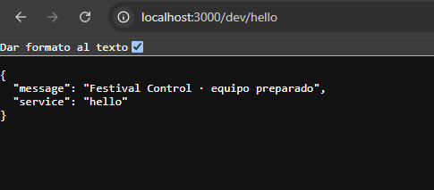

# Bloque 02
 
## Resultado
- Qué añadí al proyecto: tsconfig.json, serverless.yml, hello.ts
- Ruta o pantalla comprobada: http://localhost:3000/dev/hello
- Estado y respuesta observados:
{
  "message": "Festival Control API online"
}
 
## Comprensión
- Recorrido del dato, explicado con mis palabras: Se envia la peticion get desde thunder y el serverless lo recibe con el puerto 3000, despues obtiene la funcion del serverless.yml y carga hello.ts que es basicamente lo que se muestra al compilar
- Cambio guiado y resultado:
Cambie el mensaje del hello.ts y añadi service al body con su propio valor "hello"
{
  "message": "Festival Control · equipo preparado",
  "service": "hello"
}
- Error encontrado y cómo lo resolví: fue todo bien
 
## Evidencias
- Captura o transcripción breve, sin credenciales:v  
- Limitaciones del ejercicio:
