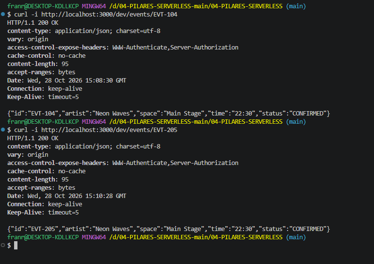

# Bloque 02
 
## Resultado
- Qué añadí al proyecto: en serverless.yml la seccion getEvent con cors abilitado, 
- Ruta o pantalla comprobada: http://localhost:3000/dev/events/EVT-104
- Estado y respuesta observados:
{
  "id": "EVT-104",
  "artist": "Neon Waves",
  "space": "Main Stage",
  "time": "22:30",
  "status": "CONFIRMED"
}
 
## Comprensión
- Recorrido del dato, explicado con mis palabras: se edita el getEvents para obtener el resultado de este ejericio y se crea un apartado para este archivo en serverless.yml habilitando cors
- Cambio guiado y resultado: 
- Error encontrado y cómo lo resolví: Error al intentar probar el curl, la cosa es que intente en powershell y el comando era de git bash 
 
## Evidencias
- Captura o transcripción breve, sin credenciales:
- Limitaciones del ejercicio:
 