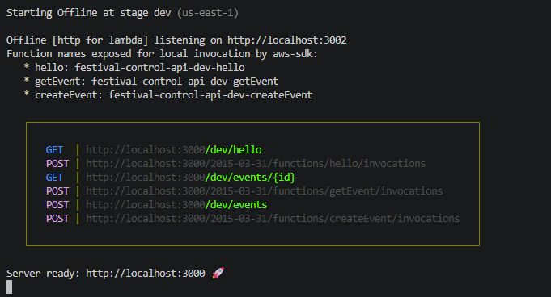
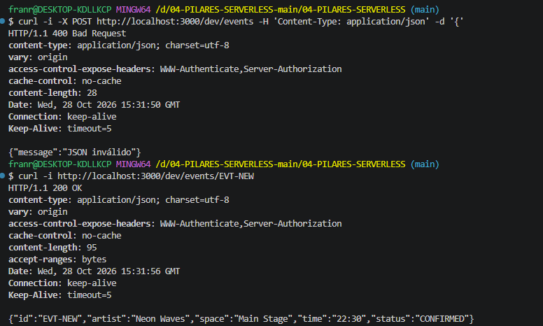
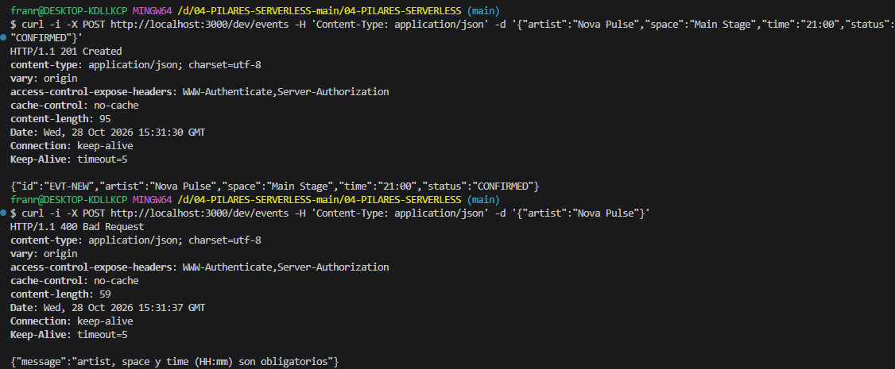

# Bloque 03
 
## Resultado
- Qué añadí al proyecto: createEvent.ts, editar el serverless.yml para añadir apartado al createEvent.ts, 
- Ruta o pantalla comprobada: http://localhost:3000/dev/events/EVT-NEW
- Estado y respuesta observados:
 {
  "id": "EVT-NEW",
  "artist": "Neon Waves",
  "space": "Main Stage",
  "time": "22:30",
  "status": "CONFIRMED"
}

## Comprensión
- Recorrido del dato, explicado con mis palabras: Mando el POST desde Thunder Client y el handler lo recibe. Comprueba que el JSON sea válido y que artist, space y time estén bien luego mira el status. Si todo está bien devuelve 201 con EVT-NEW; si algo falla devuelve 400 con un mensaje y no sigue.
- Cambio guiado y resultado:  Repetí el POST válido cambiando una sola cosa cada vez. Con status CANCELLED [201],
  con status PAUSED [400]
- Error encontrado y cómo lo resolví:
 
## Evidencias
- Captura o transcripción breve, sin credenciales: , , 
- Limitaciones del ejercicio:
 