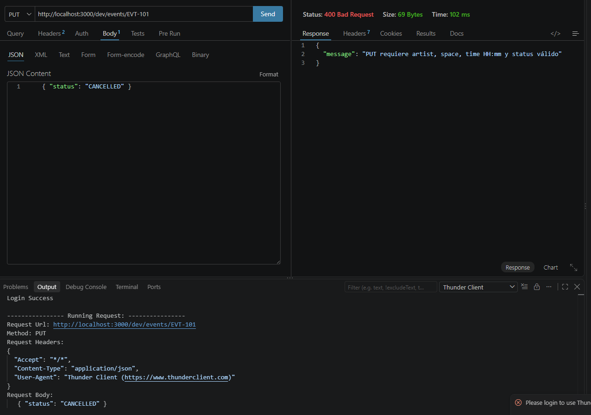
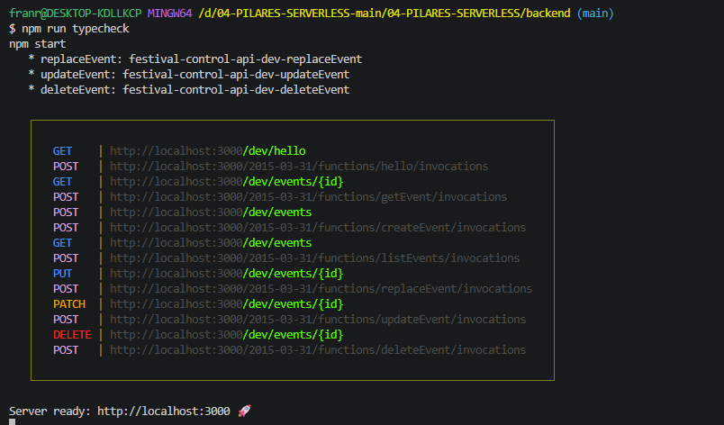
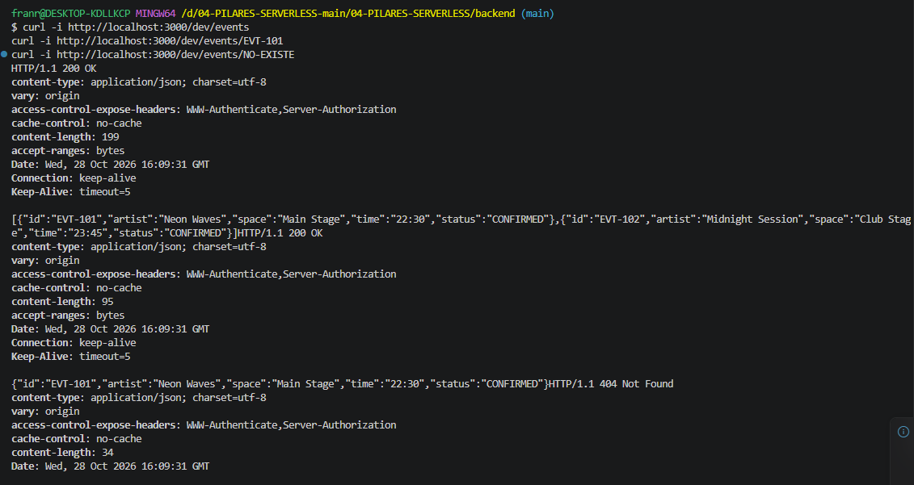
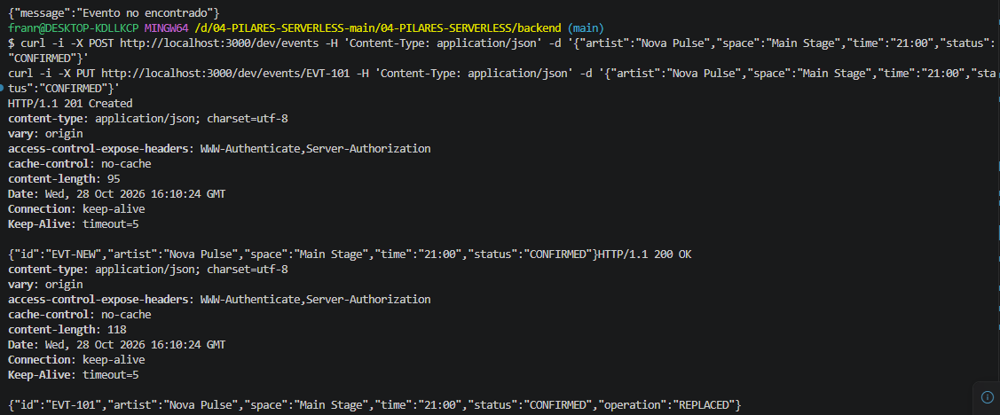
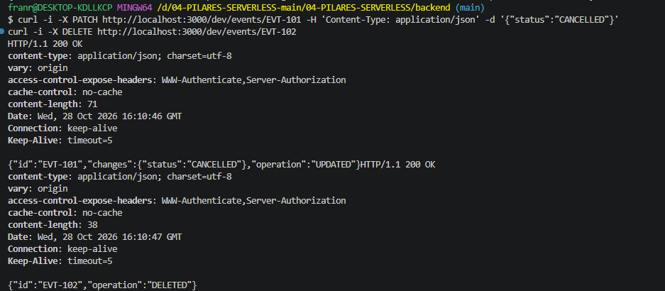
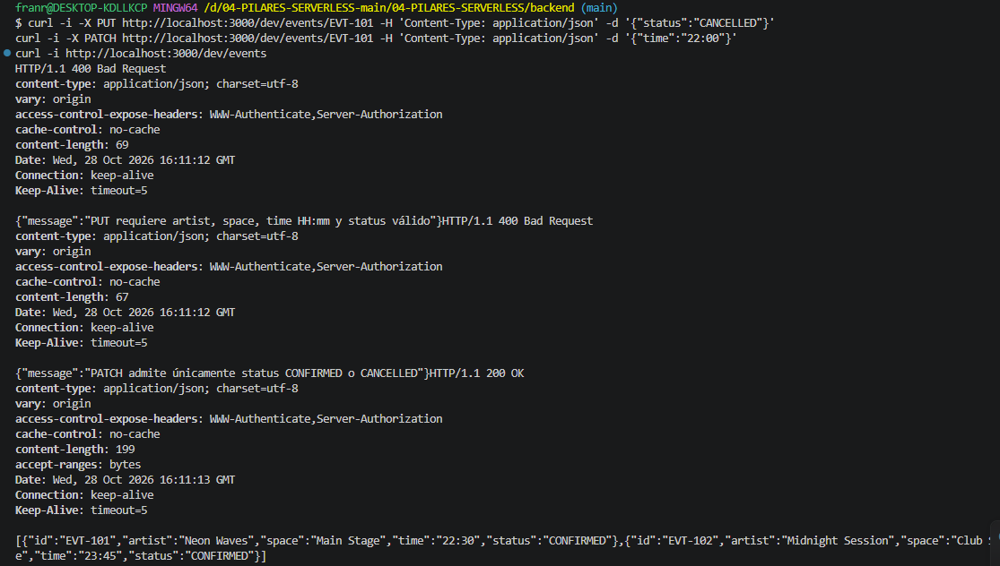
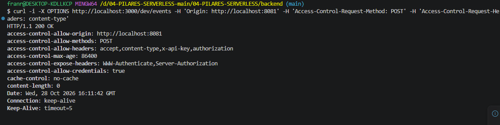

# Bloque 04
 
## Resultado
- Qué añadí al proyecto: he añadido una carpeta dentro de src llamada events y dentro he añadido archivos typescript para los distintos metodos (delete, create,get, replace...) ademas de model y list. ademas de adaptar el serverless.yml para estos añadidos
- Ruta o pantalla comprobada: http://localhost:3000/dev/events/EVT-101
- Estado y respuesta observados:
 {
  "id": "EVT-101",
  "artist": "Neon Waves",
  "space": "Main Stage",
  "time": "22:30",
  "status": "CONFIRMED"
}

## Comprensión
- Recorrido del dato, explicado con mis palabras: en serverless.yml estan configurados los distintos metodos y estos se establecen en la carpeta events donde se establece el mensaje 200...
- Cambio guiado y resultado: 
- Error encontrado y cómo lo resolví:
 
## Evidencias
- Captura o transcripción breve, sin credenciales:, , , , , 
- Limitaciones del ejercicio:
 