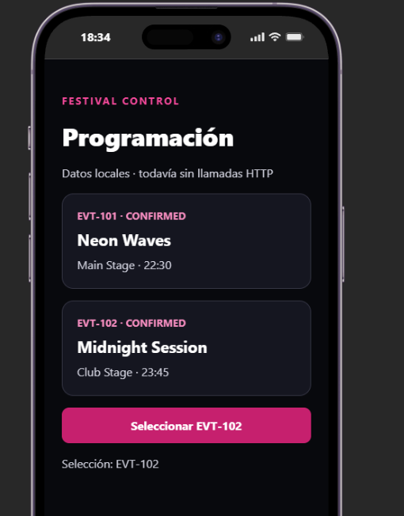

# Bloque 05
 
## Resultado
- Qué añadí al proyecto: he añadido la carpeta mobile y dentro archivos de cofiguracion tipo packag.json, tsconfig.json... ademas del app.tsx 
- Ruta o pantalla comprobada: http://localhost:8081/
- Estado y respuesta observados:
  
## Comprensión
- Recorrido del dato, explicado con mis palabras: los valores del dato estan en types.ts y desde app.tsx les llama y constrye los datos que luego se muestran al llamrlos
- Cambio guiado y resultado: 
- Error encontrado y cómo lo resolví:
 
## Evidencias
- Captura o transcripción breve, sin credenciales: 
- Limitaciones del ejercicio:
 