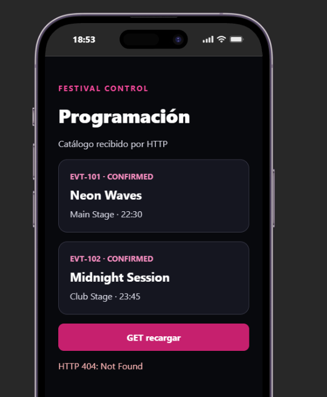
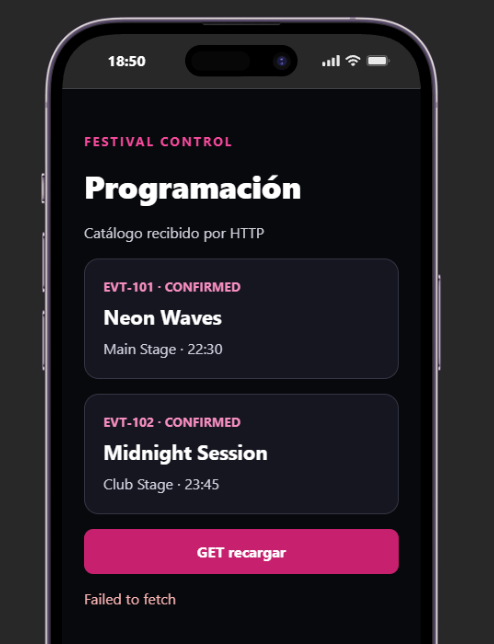
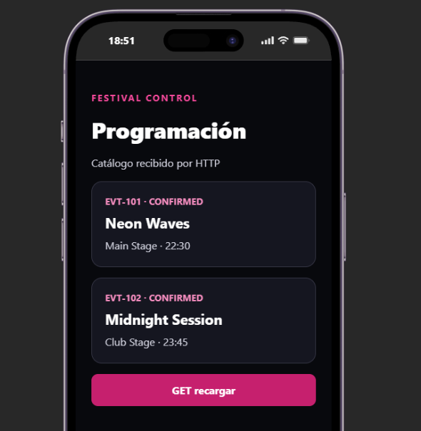

# Bloque 06
 
## Resultado
- Qué añadí al proyecto: api.ts, actualizar el app.tsx
- Ruta o pantalla comprobada: http://localhost:8081/  http://localhost:3000/dev/events
- Estado y respuesta observados:
[
  {
    "id": "EVT-101",
    "artist": "Neon Waves",
    "space": "Main Stage",
    "time": "22:30",
    "status": "CONFIRMED"
  },
  {
    "id": "EVT-102",
    "artist": "Midnight Session",
    "space": "Club Stage",
    "time": "23:45",
    "status": "CONFIRMED"
  }
]
 
## Comprensión
- Recorrido del dato, explicado con mis palabras: se inicia el backend y el frontend de mobile, el api.ts de mobile llama a GET/events del back y lo verficia para continuar
- Cambio guiado y resultado: al cambiar la ruta /events salta error (la vuelvo a dejar como estaba inicialmente) 
- Error encontrado y cómo lo resolví:
 
## Evidencias
- Captura o transcripción breve, sin credenciales: la primera imagen falla al recargar porque back esta apagado, la segunda en cambio funciona por estar encendido 
- Limitaciones del ejercicio:
 