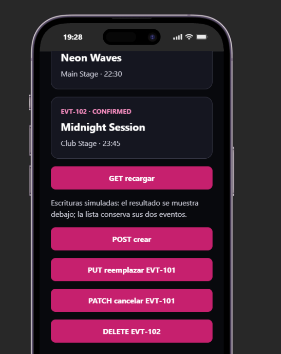
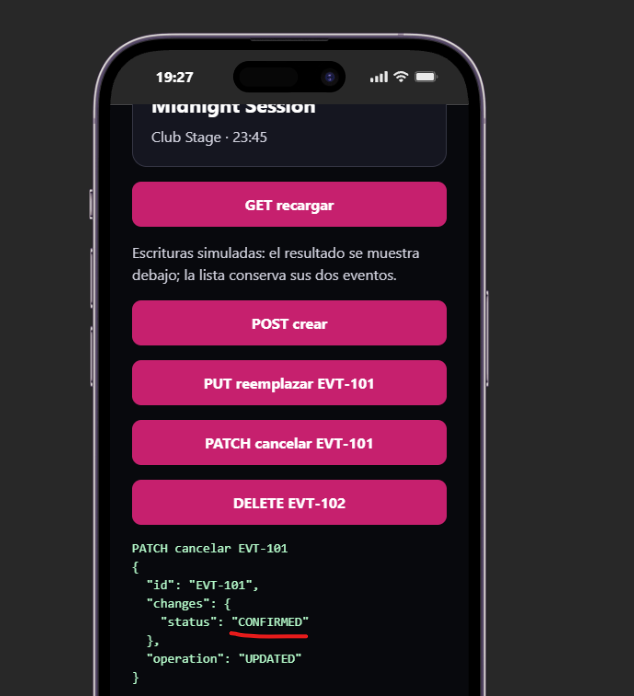
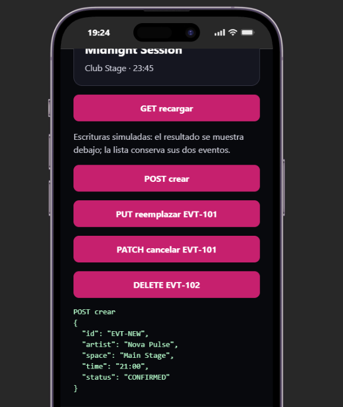
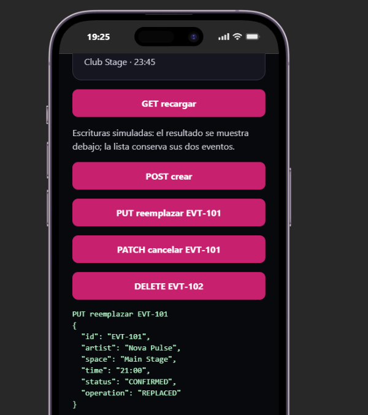
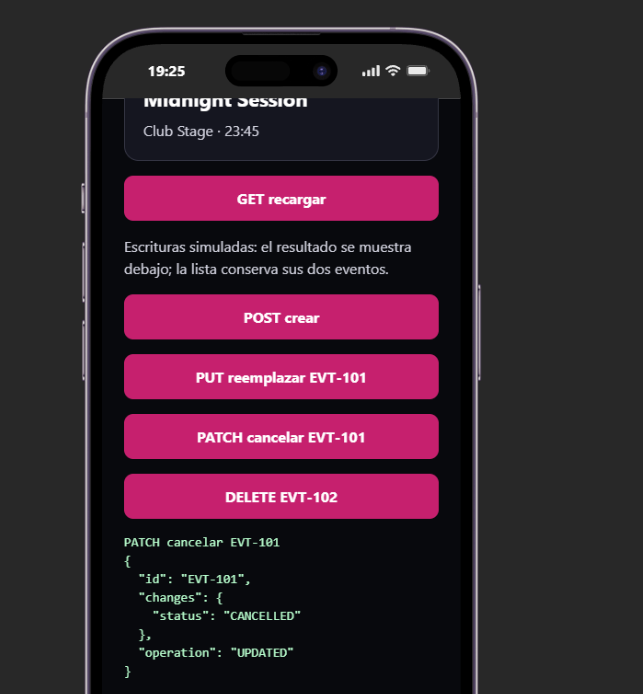
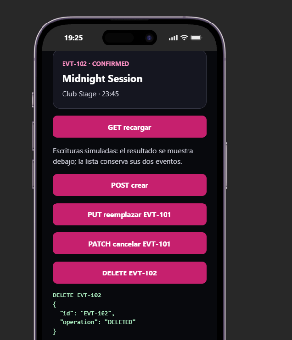

# Bloque 07
 
## Resultado
- Qué añadí al proyecto:  funciones de cliente a api.ts de cada metodo, y a app.tsx
- Ruta o pantalla comprobada: http://localhost:8081/
- Estado y respuesta observados: 
 
## Comprensión
- Recorrido del dato, explicado con mis palabras:
- Cambio guiado y resultado: 
- Error encontrado y cómo lo resolví:
 
## Evidencias
- Captura o transcripción breve, sin credenciales:     
- Limitaciones del ejercicio:
 