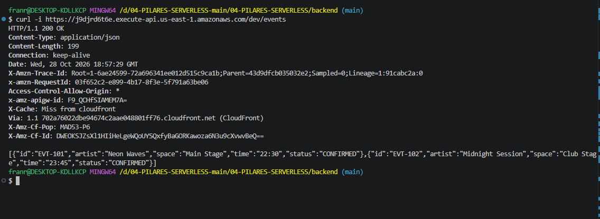

# Bloque 08
 
## Resultado
- Qué añadí al proyecto: credenciales de academy, actualizar serverless.yml con aws
- Ruta o pantalla comprobada:
- Estado y respuesta observados:
[
  {
    "id": "EVT-101",
    "artist": "Neon Waves",
    "space": "Main Stage",
    "time": "22:30",
    "status": "CONFIRMED"
  },
  {
    "id": "EVT-102",
    "artist": "Midnight Session",
    "space": "Club Stage",
    "time": "23:45",
    "status": "CONFIRMED"
  }
]
 
## Comprensión
- Recorrido del dato, explicado con mis palabras: implementamos aws en el proyecto con las credenciales temporales y configuramos el rol de iam, en serverless.yml actualizamos la parte del provider
- Cambio guiado y resultado:
- Error encontrado y cómo lo resolví:
 
## Evidencias
- Captura o transcripción breve, sin credenciales: 
- Limitaciones del ejercicio:
 