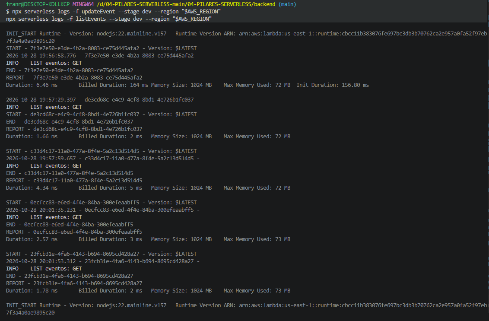
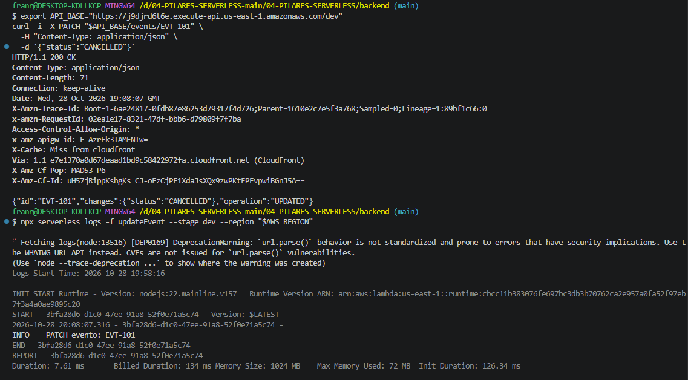
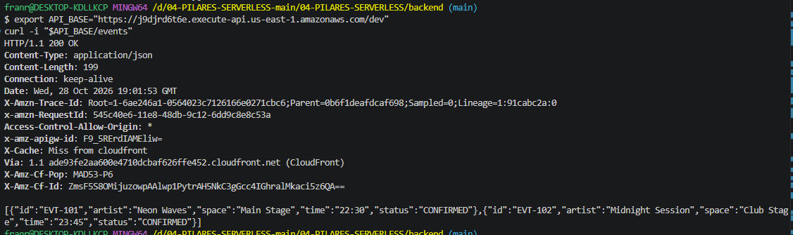

# Bloque 09
 
## Resultado
- Qué añadí al proyecto: añadi al api.ts la referencia a la ruta de aws 
- Ruta o pantalla comprobada:
- Estado y respuesta observados:
 
## Comprensión
- Recorrido del dato, explicado con mis palabras:  La app llama a la URL de API Gateway, que lanza la función Lambda y la respuesta vuelve a la app.
- Cambio guiado y resultado:
- Error encontrado y cómo lo resolví:
 
## Evidencias
- Captura o transcripción breve, sin credenciales:  
- Limitaciones del ejercicio:
 